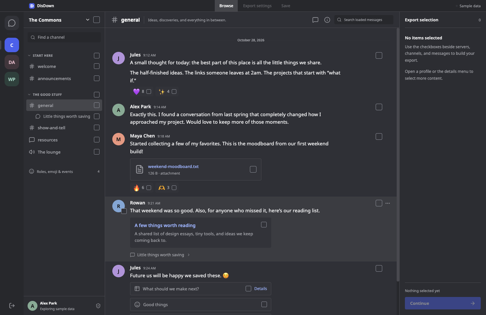

<p align="center"></p>
<h1 align="center">DisDown</h1>
<p align="center">A local Discord archive client.</p>

DisDown is a local, read-only desktop app for choosing accessible Discord content and saving it to your computer. Browse a familiar server rail, channel tree, and conversation view. Build a collection without leaving the conversation, choose an export format, then save through DisDown’s themed folder browser.



## Download

Get the installer for your platform from [GitHub Releases](https://github.com/H644b/DisDown/releases). The release page records exactly which builds and live checks have passed.

| Platform            | Packages                |
| ------------------- | ----------------------- |
| macOS Apple Silicon | DMG, ZIP                |
| macOS Intel         | DMG, ZIP                |
| Windows x64         | Setup EXE, portable EXE |
| Linux x64           | AppImage, DEB           |

Initial builds are not signed with a Developer ID, notarized by Apple, or signed with a Windows publisher certificate. Operating systems may show publisher warnings. This is distinct from the app’s test status. See [installation](docs/INSTALLING.md).

## Before connecting

**Discord prohibits automating normal user accounts outside its OAuth2/bot API and says it may terminate accounts that do so.** User-token mode is unsupported by Discord and its endpoints may change. Read [Discord’s policy](https://support.discord.com/hc/en-us/articles/115002192352-Automated-User-Accounts-Self-Bots). Explicit in-app consent and policy acknowledgement are required before a user-token connection.

Bot tokens are supported. A bot can only access servers it belongs to and data permitted to that bot. It cannot mirror your personal servers, DMs, or group conversations. A bot may need the Message Content privileged intent to receive full message bodies.

Only provide a token you own or are authorized to use. **Never put a token in an issue, screenshot, chat, shell command, or configuration file.** DisDown does not discover tokens, read other apps’ credentials, or keep a token on disk. A token is used in memory to make HTTPS requests directly to Discord, then dropped on disconnect or exit. No DisDown backend or telemetry is used.

## Choose → Configure → Save

1. Open DisDown and connect after consenting, or explore the clearly labeled sample workspace.
2. Use the checkboxes beside servers, categories, channels, DMs, group chats, threads, messages, reactions, authors, attachments, embeds, stickers, polls, message components, roles, emoji, and events. Open a profile or object inspector to select individual returned fields.
   Forum and media channels open directly to a paged post list. Open a post to read its messages, use **Back to forum** to return, or select the entire post. **Load more posts** continues through active and archived results.
3. Click **Continue** in the persistent **Export selection** pane. Choose HTML, JSON, CSV, Markdown, or plain text. Apply UTC date filters, a message phrase, author IDs, or a matching-message limit per channel.
4. Choose optional threads, reaction counts, author profiles, and attachment downloads. Downloaded attachments require a ZIP bundle.
5. Click **Continue to save**, then **Save export**. Browse folders in the app, create a folder if needed, and choose the destination. Existing files are replaced only after explicit confirmation. Progress reports real collection, media, and writing phases. Cancelled or failed exports remove their temporary files.

A broad selection expands during export. A leaf selection keeps its scope: selecting a reaction does not silently include its message or channel. Overlapping selections are deduplicated. A ZIP contains the selected format, a JSON data copy (when needed), a manifest, and downloaded media. Standalone files preserve metadata in the chosen format.

## Your Discord theme

User-token sessions read the account’s appearance settings and apply its light, dark, darker, midnight, or system theme, including the current 24 Nitro presets and custom gradients. The same theme covers browsing, export settings, and the in-app folder picker. Use **Sync Discord theme** beside the connection status after changing your Discord appearance; DisDown also refreshes when its window regains focus, at most once per minute.

Bot sessions and sample previews use the standard dark theme. If appearance settings are unavailable, the connection stays usable and an access notice explains how to retry. This uses an undocumented, read-only settings endpoint; Discord can change its format. DisDown does not change your Discord settings or persist the settings response. Server images fill their rounded icons, with initials for missing or unavailable images.

## Access and completeness

DisDown archives the data Discord returns for the connected account. It cannot retrieve deleted content, unseen private threads, unavailable media, or data blocked by server permissions or API restrictions. It does not record voice/video calls, streams, presence history, or reconstruct every interactive Discord feature. Voice/stage channels can expose metadata and available text history; this is not audio capture.

User DM discovery, thread search, and extended profiles use undocumented endpoints. Failure is shown as an access notice. Server channel visibility follows guild roles and channel overrides. Active and accessible archived threads are paginated; private-thread permissions may prevent complete discovery. The inspector exposes all fields of the returned object; it does not imply every field available in the official Discord client is accessible through an API.

Large exports are limited to 250,000 distinct messages per job and 512 MB per downloaded file. Use date ranges or smaller selections for larger histories. Permission failures, expired attachments, API failures, and limits are reported in the archive. Do not interpret a finished save as proof that Discord supplied all possible account content.

**Pseudonymize author names** changes author display names only. Message text, IDs, quotes, and individually selected fields may still identify people. This is not full anonymization.

## Development

Use Node 22.12+ (CI uses Node 24).

```sh
npm ci
npm run dev
```

The browser preview (`npm run dev:web`) uses sample data only. Token connections and filesystem access require Electron.

```sh
npm run build          # TypeScript, Vite, main process and isolated preload
npm test               # API, permissions, scope, formats, files, cancellation
npm run test:e2e       # Real Electron desktop interactions and saving
npm run test:desktop   # Desktop launch smoke check
npm run dist           # Build installers on the current OS
npm run notarize:mac   # Sign/notarize both released Mac ZIPs using local credentials
```

On Linux without a desktop session, run Electron checks under `xvfb-run --auto-servernum`. CI uses `--no-sandbox` only inside its disposable Linux test runner; shipped app code keeps renderer sandboxing enabled.

The [verification matrix](docs/VERIFICATION.md) separates automated fixtures, live Discord access, and platform build evidence. The [architecture notes](docs/ARCHITECTURE.md) describe credentials, IPC, permissions, archive scope, and file writes.

The [macOS notarization workflow](docs/NOTARIZATION.md) documents local signing credentials, resuming Apple submissions, ticket verification, and release replacement. Credentials are kept out of public CI.

## Privacy and security

No analytics, account database, remote frontend code, or automatic uploads. Images in live browsing are loaded from Discord’s CDN. API calls are GET-only. Attachment fetches send no authorization header and are restricted to Discord media hosts with redirects rejected. Exported HTML escapes data, runs without scripts, and avoids loading remote media. CSV cells guard against spreadsheet formula injection.

Tokens and archive content are sensitive. Export only content you have permission to keep, and protect the files you save. To report a security issue, see [SECURITY.md](SECURITY.md).

DisDown is independent software, not affiliated with or endorsed by Discord. Discord names and data belong to their respective owners. The DisDown logo is an original vector mark in `public/logo.svg`. Code is [MIT licensed](LICENSE).
